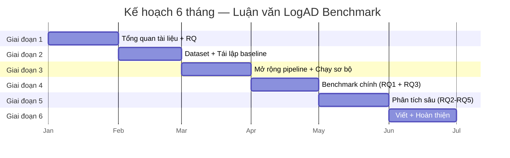

# KẾ HOẠCH THỰC HIỆN LUẬN VĂN THẠC SĨ (CHI TIẾT 6 THÁNG)

---

## TỔNG QUAN

---

## GIAI ĐOẠN 1: TỔNG QUAN TÀI LIỆU VÀ XÁC ĐỊNH PHẠM VI (Tháng 1)

### Tuần 1-2: Nghiên cứu tài liệu

| # | Task | Output |
|---|---|---|
| 1.1 | Đọc kỹ 6 bài báo gốc (CoLog, LightAD, LogFormer, LogRAG, Logs2Graph, SemPCA) | Bảng tóm tắt cho mỗi bài: kiến trúc, data, metric, kết quả, hạn chế |
| 1.2 | Đọc 20-25 bài báo liên quan (DeepLog, LogAnomaly, LogRobust, LogBERT, FastLogAD, etc.) | Bảng tổng hợp ≥30 bài báo |
| 1.3 | Đọc LogHub dataset documentation (Zhu et al., ISSRE 2023) | Hiểu rõ HDFS_v3, BGL, OpenStack |
| 1.4 | Nghiên cứu ACM SIGSOFT Empirical Standards | Checklist cho thiết kế thực nghiệm |

### Tuần 3: Xác định phạm vi

| # | Task | Output |
|---|---|---|
| 1.5 | Hoàn thiện 5 RQ với justification | RQ document được duyệt |
| 1.6 | Xác định rõ in-scope vs. out-of-scope | Scope document |
| 1.7 | Phân tích rủi ro tái lập cho mỗi baseline | Risk matrix |

### Tuần 4: Viết Chương 1 + 2 (bản nháp)

| # | Task | Output |
|---|---|---|
| 1.8 | Viết bản nháp Chương 1 (Giới thiệu) | ~15-20 trang |
| 1.9 | Viết bản nháp Chương 2 (Cơ sở lý thuyết) | ~25-30 trang |
| 1.10 | Trình người hướng dẫn duyệt RQ + scope | Feedback → điều chỉnh |

> **Deliverable:** Bảng tổng hợp ≥30 bài báo; RQ được chốt; bản nháp Chương 1-2

---

## GIAI ĐOẠN 2: THU THẬP DỮ LIỆU VÀ TÁI LẬP BASELINE (Tháng 2)

### Tuần 1: Thiết lập môi trường

| # | Task | Output |
|---|---|---|
| 2.1 | Tạo virtual environments cho các nhóm phương pháp | env configs |
| 2.2 | Cài đặt dependencies: PyTorch 1.13, transformers 4.x, scikit-learn 0.24/latest, spaCy, GloVe | `requirements.txt` cho mỗi env |
| 2.3 | Tải datasets từ LogHub: HDFS_v3, BGL, OpenStack | Raw data files |
| 2.4 | Tải pretrained models: BigLog (LogRAG), GloVe 6B 300d (SemPCA), en_core_web_lg (CoLog) | Pretrained files |

### Tuần 2: Tái lập baseline 1-3

| # | Task | Output | Rủi ro |
|---|---|---|---|
| 2.5 | **LightAD:** Fix hardcoded paths; chạy `preprocess.py --dataset hdfs` → `main_hdfs.py --model knn/dt/slfn` | Kết quả trên HDFS, BGL | Thấp — code đơn giản |
| 2.6 | **SemPCA:** Tải GloVe; chạy `PCA_PlusPlus.sh` cho HDFS, BGL | Kết quả PCA++ | Trung bình — scikit-learn version |
| 2.7 | **LogFormer:** Drain parsing → `train_transformer.py` → `tune_transformer.py` cho HDFS, BGL, OpenStack | Pre-train + adapter tune results | Trung bình — cần GPU |

### Tuần 3: Tái lập baseline 4-6

| # | Task | Output | Rủi ro |
|---|---|---|---|
| 2.8 | **Logs2Graph:** Set `root_path`; `GraphGeneration_HDFS.py` → `main_HDFS.py`; tương tự BGL | Graph-based results | Trung bình — data format specific |
| 2.9 | **CoLog:** Preprocessing → `train.py --dataset hadoop` → `test.py` cho Hadoop, BGL | CoLog results | Trung bình — Hadoop ≠ HDFS_v3 |
| 2.10 | **LogRAG:** Set API key; `config.yaml` → `python main.py` cho BGL | DeepSVDD + RAG results | Cao — cần API key, chi phí $ |

### Tuần 4: Pipeline tiền xử lý thống nhất

| # | Task | Output |
|---|---|---|
| 2.11 | Chạy Drain parsing thống nhất cho HDFS_v3, BGL, OpenStack | `*_structured.csv` files |
| 2.12 | Xây dựng data splitting scripts (80/10/10) | `split_data.py` |
| 2.13 | Xây dựng evaluation scripts thống nhất (P/R/F1/PR-AUC/FPR) | `evaluate.py` |
| 2.14 | So sánh kết quả tái lập với bài báo gốc; ghi nhận sai khác | Reproduction report |

> **Deliverable:** 6 baselines chạy được trên datasets gốc; pipeline tiền xử lý thống nhất; reproduction report

> [!WARNING]
> **Dự phòng:** Nếu một baseline không thể tái lập sau 2 tuần cố gắng, ghi nhận lý do chi tiết và điều chỉnh phạm vi. Không trì hoãn toàn bộ kế hoạch. LogRAG có rủi ro cao nhất (API dependency).

---

## GIAI ĐOẠN 3: MỞ RỘNG PIPELINE VÀ CHẠY SƠ BỘ (Tháng 3)

### Tuần 1-2: Mở rộng pipeline đầu vào cho OpenStack

| # | Task | Chi tiết kỹ thuật | Output |
|---|---|---|---|
| 3.1 | **LightAD → OpenStack** | Thêm OpenStack loader trong `utils.py`; tạo `preprocess.py --dataset openstack` | LightAD chạy trên OpenStack |
| 3.2 | **SemPCA → OpenStack** | Tạo dataset folder `datasets/OpenStack/`; điều chỉnh parser config và `cut_by_613` | SemPCA chạy trên OpenStack |
| 3.3 | **Logs2Graph → OpenStack** | Tạo `GraphGeneration_OpenStack.py`, `main_OpenStack.py` theo mẫu HDFS/BGL | Logs2Graph chạy trên OpenStack |
| 3.4 | **CoLog → HDFS_v3 + OpenStack** | Tạo preprocessing scripts cho HDFS_v3 (ánh xạ từ Hadoop pipeline); tạo cho OpenStack | CoLog chạy trên HDFS_v3, OpenStack |
| 3.5 | **LogRAG → HDFS_v3 + OpenStack** | Tạo `log_structured.csv` format cho HDFS_v3/OpenStack; điều chỉnh window strategy | LogRAG chạy trên HDFS_v3, OpenStack |

### Tuần 3: Validation chạy sơ bộ

| # | Task | Output |
|---|---|---|
| 3.6 | Chạy **tất cả 6 phương pháp** trên **tất cả 3 datasets** | 6×3 = 18 kết quả sơ bộ |
| 3.7 | Kiểm tra sanity: kết quả có hợp lý không? Có bug nào không? | Bug report + fixes |
| 3.8 | Đối chiếu kết quả mở rộng với kết quả gốc trên datasets chung | Validation report |

### Tuần 4: Hoàn thiện pipeline + viết Chương 3

| # | Task | Output |
|---|---|---|
| 3.9 | Hoàn thiện evaluation scripts (timing, memory profiling) | `benchmark.py` with resource monitoring |
| 3.10 | Viết bản nháp Chương 3 (Phương pháp nghiên cứu) | ~20-25 trang |
| 3.11 | Document tất cả code changes (mở rộng pipeline) | Technical documentation |

> **Deliverable:** 6×3 matrix hoàn chỉnh; kết quả sơ bộ hợp lệ; Chương 3 nháp

---

## GIAI ĐOẠN 4: CHẠY BENCHMARK CHÍNH (Tháng 4)

### Tuần 1-2: RQ1 — Benchmark hiệu quả phát hiện

| # | Task | Output |
|---|---|---|
| 4.1 | Chạy chính thức 6 phương pháp × 3 datasets × nhiều lần (seed cố định) | Raw results |
| 4.2 | Tính P/R/F1/PR-AUC/FPR cho mỗi run | Metrics tables |
| 4.3 | Tính trung bình ± std | Summary tables |
| 4.4 | Tạo bảng benchmark chéo | **Bảng RQ1 chính** |

### Tuần 3: RQ3 — Chi phí tính toán

| # | Task | Output |
|---|---|---|
| 4.5 | Đo thời gian huấn luyện (wall-clock time trên cùng GPU) | Training time table |
| 4.6 | Đo thời gian suy luận (ms/sample average) | Inference latency table |
| 4.7 | Đo bộ nhớ đỉnh GPU + RAM (nvidia-smi / memory_profiler) | Memory table |
| 4.8 | Tính throughput (samples/second) | Throughput table |
| 4.9 | Ước tính chi phí API LLM cho LogRAG | Cost analysis |

### Tuần 4: Tạo visualizations + phân tích sơ bộ

| # | Task | Output |
|---|---|---|
| 4.10 | Tạo biểu đồ F1 vs. latency (scatter plot) | Figure |
| 4.11 | Tạo biểu đồ F1 vs. memory (scatter plot) | Figure |
| 4.12 | Tạo radar chart cho mỗi dataset | Figure |
| 4.13 | Phân tích sơ bộ kết quả RQ1 + RQ3 | Analysis draft |

> **Deliverable:** Kết quả thô đầy đủ; bảng benchmark RQ1; bảng chi phí RQ3; visualizations

---

## GIAI ĐOẠN 5: PHÂN TÍCH SÂU (Tháng 5)

### Tuần 1: RQ2 — Độ ổn định

| # | Task | Output |
|---|---|---|
| 5.1 | Tính Spearman ρ và Kendall τ giữa rankings trên 3 datasets | Correlation values |
| 5.2 | Tạo heatmap thay đổi thứ hạng | Figure |
| 5.3 | Phân tích trường hợp "overfit" vào dataset đặc thù | Case study |
| 5.4 | So sánh fault injection (HDFS_v3) vs. lỗi tự nhiên (BGL) vs. cloud (OpenStack) | Comparative analysis |

### Tuần 2: RQ4 — Phát hiện sớm

| # | Task | Output |
|---|---|---|
| 5.5 | Implement prefix-based evaluation: cắt chuỗi tại 10/25/50/75/100% | `early_detection.py` |
| 5.6 | Chạy evaluation tại mỗi mốc tiền tố × 6 phương pháp × 3 datasets | Early detection results |
| 5.7 | Vẽ đường cong F1 theo tiền tố | Figures |
| 5.8 | Phân tích đánh đổi early detection vs. FPR | Analysis |

### Tuần 3: RQ5 — Phân tích lỗi

| # | Task | Output |
|---|---|---|
| 5.9 | Trích xuất 50-100 FP + 50-100 FN từ mỗi phương pháp × dataset | FP/FN samples |
| 5.10 | Phân loại thủ công theo taxonomy (unseen template, chuỗi ngắn, nhiễu, class imbalance) | Error classification |
| 5.11 | Tổng hợp tỷ lệ từng nhóm lỗi | Error distribution table |
| 5.12 | Viết case study minh họa (2-3 ví dụ cụ thể) | Case studies |
| 5.13 | Đánh giá khả năng giải thích: Logs2Graph node scores + LogRAG LLM reasoning | Explainability analysis |

### Tuần 4: Kiểm tra độ tin cậy

| # | Task | Output |
|---|---|---|
| 5.14 | Kiểm tra statistical significance (Wilcoxon / paired t-test nếu applicable) | Statistical tests |
| 5.15 | Sensitivity analysis cho hyperparameters quan trọng | Sensitivity results |
| 5.16 | Viết Chương 4 (Kết quả) + Chương 5 (Thảo luận) bản nháp | ~30-35 trang |

> **Deliverable:** Phân tích đầy đủ cho RQ2-RQ5; kiểm định thống kê; Chương 4-5 nháp

---

## GIAI ĐOẠN 6: VIẾT VÀ HOÀN THIỆN (Tháng 6)

### Tuần 1-2: Viết luận văn

| # | Task | Output |
|---|---|---|
| 6.1 | Hoàn thiện Chương 1: Giới thiệu (dựa trên kết quả thực tế) | Final Chapter 1 |
| 6.2 | Hoàn thiện Chương 2: Cơ sở lý thuyết | Final Chapter 2 |
| 6.3 | Hoàn thiện Chương 3: Phương pháp nghiên cứu | Final Chapter 3 |
| 6.4 | Hoàn thiện Chương 4: Kết quả thực nghiệm | Final Chapter 4 |
| 6.5 | Hoàn thiện Chương 5: Thảo luận | Final Chapter 5 |
| 6.6 | Viết Chương 6: Kết luận | Final Chapter 6 |
| 6.7 | Viết các Phụ lục A-G | Appendices |
| 6.8 | Tạo danh mục tài liệu tham khảo | Bibliography |

### Tuần 3: Rà soát và hoàn thiện

| # | Task | Output |
|---|---|---|
| 6.9 | Rà soát toàn bộ luận văn: logic, nhất quán, chính tả | Revised draft |
| 6.10 | Hoàn thiện tất cả hình vẽ, bảng biểu | Final figures/tables |
| 6.11 | Chuẩn bị repository công khai: code + data + scripts + documentation | Public repository |
| 6.12 | Gửi cho người hướng dẫn review | Feedback → revisions |

### Tuần 4: Chuẩn bị bảo vệ

| # | Task | Output |
|---|---|---|
| 6.13 | Sửa theo feedback người hướng dẫn | Final thesis |
| 6.14 | Tạo slide bảo vệ (30-40 slides) | Presentation |
| 6.15 | Luyện trình bày (15-20 phút) | Practice |
| 6.16 | Chuẩn bị câu hỏi phản biện dự kiến | Q&A preparation |

> **Deliverable:** Bản luận văn hoàn chỉnh; repository công khai; slide bảo vệ

---

## TỔNG HỢP RISKS & MITIGATIONS

| Risk | Likelihood | Impact | Mitigation |
|---|---|---|---|
| LogRAG API key không khả dụng / chi phí cao | Cao | Cao | Dùng Mistral-7B local thay GPT; hoặc giới hạn số lần RAG evaluation |
| SemPCA scikit-learn 0.24 không tương thích | Trung bình | Thấp | Docker container riêng với Python 3.8 + scikit-learn 0.24 |
| Mở rộng pipeline cho OpenStack gây bias | Trung bình | Trung bình | Ghi rõ khác biệt; chạy ablation trên dataset gốc để đối chiếu |
| GPU không đủ cho CoLog/LogFormer training | Thấp | Cao | Dùng Google Colab Pro hoặc cloud GPU; giảm batch_size |
| Kết quả tái lập khác xa bài báo gốc | Trung bình | Cao | Ghi nhận sai khác; liên hệ tác giả gốc; kiểm tra hyperparameters |
| Dataset HDFS_v3 quá lớn (14.8M dòng) | Thấp | Trung bình | Sampling có kiểm soát nếu cần; báo cáo rõ |
| Thời gian viết không đủ | Trung bình | Cao | Viết song song với thực nghiệm (nháp Chương 1-3 sớm) |

---

## CHECKLIST TỔNG THỂ

- [ ] **Tháng 1:** ≥30 bài báo tổng hợp; RQ được duyệt; Chương 1-2 nháp
- [ ] **Tháng 2:** 6 baselines chạy được; pipeline tiền xử lý; reproduction report
- [ ] **Tháng 3:** 6×3 matrix hoàn chỉnh; kết quả sơ bộ; Chương 3 nháp
- [ ] **Tháng 4:** Benchmark RQ1 + RQ3 hoàn tất; visualizations
- [ ] **Tháng 5:** Phân tích RQ2-RQ5; kiểm định thống kê; Chương 4-5 nháp
- [ ] **Tháng 6:** Luận văn hoàn chỉnh; repository; slide bảo vệ
