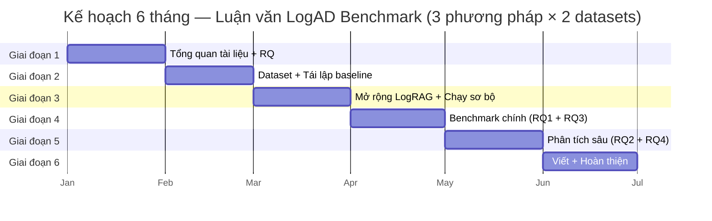

# KẾ HOẠCH THỰC HIỆN LUẬN VĂN THẠC SĨ (CHI TIẾT 6 THÁNG)

---

## TỔNG QUAN

**Thay đổi so với kế hoạch ban đầu:**
- Giảm từ 6 phương pháp xuống **3 phương pháp** (LightAD, LogFormer, LogRAG)
- Giảm từ 3 datasets xuống **2 datasets** (HDFS_v3, BGL)
- Bỏ RQ4 về phát hiện sớm (early detection)
- Giảm từ 5 RQ xuống **4 RQ**
- Giảm đáng kể công việc mở rộng pipeline (chỉ cần mở rộng LogRAG cho HDFS_v3)

---

## GIAI ĐOẠN 1: TỔNG QUAN TÀI LIỆU VÀ XÁC ĐỊNH PHẠM VI (Tháng 1)

### Tuần 1-2: Nghiên cứu tài liệu

| # | Task | Output |
|---|---|---|
| 1.1 | Đọc kỹ 3 bài báo gốc (LightAD, LogFormer, LogRAG) | Bảng tóm tắt cho mỗi bài: kiến trúc, data, metric, kết quả, hạn chế |
| 1.2 | Đọc 20-25 bài báo liên quan (DeepLog, LogAnomaly, LogRobust, LogBERT, CoLog, Logs2Graph, SemPCA, etc.) | Bảng tổng hợp ≥25 bài báo |
| 1.3 | Đọc LogHub dataset documentation (Zhu et al., ISSRE 2023) | Hiểu rõ HDFS_v3, BGL |
| 1.4 | Nghiên cứu ACM SIGSOFT Empirical Standards | Checklist cho thiết kế thực nghiệm |

### Tuần 3: Xác định phạm vi

| # | Task | Output |
|---|---|---|
| 1.5 | Hoàn thiện 4 RQ với justification | RQ document được duyệt |
| 1.6 | Xác định rõ in-scope (3 phương pháp, 2 datasets) vs. out-of-scope | Scope document |
| 1.7 | Phân tích rủi ro tái lập cho mỗi baseline | Risk matrix (rủi ro giảm đáng kể so với 6 phương pháp) |

### Tuần 4: Viết Chương 1 + 2 (bản nháp)

| # | Task | Output |
|---|---|---|
| 1.8 | Viết bản nháp Chương 1 (Giới thiệu) | ~15-20 trang |
| 1.9 | Viết bản nháp Chương 2 (Cơ sở lý thuyết) | ~20-25 trang (giảm từ 25-30 trang) |
| 1.10 | Trình người hướng dẫn duyệt RQ + scope | Feedback → điều chỉnh |

> **Deliverable:** Bảng tổng hợp ≥25 bài báo; 4 RQ được chốt; bản nháp Chương 1-2

---

## GIAI ĐOẠN 2: THU THẬP DỮ LIỆU VÀ TÁI LẬP BASELINE (Tháng 2)

### Tuần 1: Thiết lập môi trường

| # | Task | Output |
|---|---|---|
| 2.1 | Tạo virtual environment chung (Python 3.8+) | env config |
| 2.2 | Cài đặt dependencies: PyTorch 1.13+, transformers 4.x, scikit-learn latest | `requirements.txt` |
| 2.3 | Tải datasets từ LogHub: HDFS_v3, BGL | Raw data files |
| 2.4 | Tải pretrained models: BigLog (LogRAG) | Pretrained files |

### Tuần 2: Tái lập baseline 1-2

| # | Task | Output | Rủi ro |
|---|---|---|---|
| 2.5 | **LightAD:** Fix hardcoded paths; chạy `preprocess.py --dataset hdfs` → `main_hdfs.py --model knn/dt/slfn`; tương tự cho BGL | Kết quả trên HDFS_v3, BGL | Thấp — code đơn giản, đã hỗ trợ đầy đủ |
| 2.6 | **LogFormer:** Drain parsing → `train_transformer.py` → `tune_transformer.py` cho HDFS_v3, BGL | Pre-train + adapter tune results | Trung bình — cần GPU, đã hỗ trợ đầy đủ |

### Tuần 3: Tái lập baseline 3

| # | Task | Output | Rủi ro |
|---|---|---|---|
| 2.7 | **LogRAG:** Set API key hoặc setup Mistral-7B local; `config.yaml` → `python main.py` cho BGL | DeepSVDD + RAG results trên BGL | Cao — cần API key, chi phí $ (hoặc GPU cho Mistral-7B) |
| 2.8 | Kiểm tra kết quả tái lập LogRAG trên BGL với bài báo gốc | Reproduction report cho LogRAG | |

### Tuần 4: Pipeline tiền xử lý thống nhất

| # | Task | Output |
|---|---|---|
| 2.9 | Chạy Drain parsing thống nhất cho HDFS_v3, BGL | `*_structured.csv` files |
| 2.10 | Xây dựng data splitting scripts (80/10/10) | `split_data.py` |
| 2.11 | Xây dựng evaluation scripts thống nhất (P/R/F1/PR-AUC/FPR) | `evaluate.py` |
| 2.12 | So sánh kết quả tái lập với bài báo gốc; ghi nhận sai khác | Reproduction report |

> **Deliverable:** 3 baselines chạy được trên datasets gốc (LightAD và LogFormer trên cả 2 datasets; LogRAG trên BGL); pipeline tiền xử lý thống nhất; reproduction report

> [!WARNING]
> **Dự phòng:** LogRAG có rủi ro cao nhất (API dependency hoặc cần GPU cho local LLM). Nếu không thể tái lập sau 1.5 tuần, xem xét giảm xuống 2 phương pháp (LightAD + LogFormer) và báo cáo rõ lý do.

---

## GIAI ĐOẠN 3: MỞ RỘNG LOGRAG VÀ CHẠY SƠ BỘ (Tháng 3)

### Tuần 1-2: Mở rộng LogRAG cho HDFS_v3

| # | Task | Chi tiết kỹ thuật | Output |
|---|---|---|---|
| 3.1 | **LogRAG → HDFS_v3** | Tạo `log_structured.csv` format cho HDFS_v3; điều chỉnh window strategy theo trace ID thay vì time window | LogRAG chạy trên HDFS_v3 |
| 3.2 | Validation kết quả | Kiểm tra output có hợp lý; debug nếu cần | |

**Lợi ích của phạm vi giảm:**
- Chỉ cần mở rộng 1 phương pháp (LogRAG) cho 1 dataset (HDFS_v3)
- LightAD và LogFormer đã hỗ trợ đầy đủ cả 2 datasets
- Giảm 5 tuần công việc mở rộng (so với kế hoạch ban đầu)

### Tuần 3: Validation chạy sơ bộ

| # | Task | Output |
|---|---|---|
| 3.3 | Chạy **tất cả 3 phương pháp** trên **tất cả 2 datasets** | 3×2 = 6 kết quả sơ bộ |
| 3.4 | Kiểm tra sanity: kết quả có hợp lý không? Có bug nào không? | Bug report + fixes |
| 3.5 | Đối chiếu kết quả với bài báo gốc | Validation report |

### Tuần 4: Hoàn thiện pipeline + viết Chương 3

| # | Task | Output |
|---|---|---|
| 3.6 | Hoàn thiện evaluation scripts (timing, memory profiling) | `benchmark.py` with resource monitoring |
| 3.7 | Viết bản nháp Chương 3 (Phương pháp nghiên cứu) | ~15-20 trang (giảm từ 20-25 trang) |
| 3.8 | Document tất cả code changes (mở rộng LogRAG) | Technical documentation |

> **Deliverable:** 3×2 matrix hoàn chỉnh; kết quả sơ bộ hợp lệ; Chương 3 nháp

---

## GIAI ĐOẠN 4: CHẠY BENCHMARK CHÍNH (Tháng 4)

### Tuần 1-2: RQ1 — Benchmark hiệu quả phát hiện

| # | Task | Output |
|---|---|---|
| 4.1 | Chạy chính thức 3 phương pháp × 2 datasets × nhiều lần (seed cố định) | Raw results |
| 4.2 | Tính P/R/F1/PR-AUC/FPR cho mỗi run | Metrics tables |
| 4.3 | Tính trung bình ± std | Summary tables |
| 4.4 | Tạo bảng benchmark chéo (3 × 2 × metrics) | **Bảng RQ1 chính** |

### Tuần 3: RQ3 — Chi phí tính toán

| # | Task | Output |
|---|---|---|
| 4.5 | Đo thời gian huấn luyện (wall-clock time trên cùng GPU) | Training time table |
| 4.6 | Đo thời gian suy luận (ms/sample average) | Inference latency table |
| 4.7 | Đo bộ nhớ đỉnh GPU + RAM (nvidia-smi / memory_profiler) | Memory table |
| 4.8 | Tính throughput (samples/second) | Throughput table |
| 4.9 | Ước tính chi phí API LLM cho LogRAG | Cost analysis (USD) |

### Tuần 4: Tạo visualizations + phân tích sơ bộ

| # | Task | Output |
|---|---|---|
| 4.10 | Tạo biểu đồ F1 vs. latency (scatter plot) | Figure |
| 4.11 | Tạo biểu đồ F1 vs. memory (scatter plot) | Figure |
| 4.12 | Tạo radar chart / bar chart so sánh 3 phương pháp | Figure |
| 4.13 | Phân tích sơ bộ kết quả RQ1 + RQ3 | Analysis draft |

> **Deliverable:** Kết quả thô đầy đủ; bảng benchmark RQ1; bảng chi phí RQ3; visualizations

**Lợi ích phạm vi giảm:**
- 6 experiments (3×2) thay vì 18 experiments (6×3)
- Thời gian chạy giảm ~66%
- Dễ kiểm soát chất lượng và tái lập

---

## GIAI ĐOẠN 5: PHÂN TÍCH SÂU (Tháng 5)

### Tuần 1-2: RQ2 — Độ ổn định

| # | Task | Output |
|---|---|---|
| 5.1 | Tính Spearman ρ và Kendall τ giữa rankings trên 2 datasets | Correlation values |
| 5.2 | Tạo heatmap / visualization thay đổi thứ hạng | Figure |
| 5.3 | Phân tích trường hợp "overfit" vào dataset đặc thù | Case study |
| 5.4 | **So sánh quan trọng:** fault injection (HDFS_v3) vs. lỗi tự nhiên (BGL) | Comparative analysis |
| 5.5 | Phân tích: phương pháp nào ổn định nhất? | Stability report |

### Tuần 3: RQ4 — Phân tích lỗi

| # | Task | Output |
|---|---|---|
| 5.6 | Trích xuất 50-100 FP + 50-100 FN từ mỗi phương pháp × dataset | FP/FN samples (3×2 = 6 sets) |
| 5.7 | Phân loại thủ công theo taxonomy (unseen template, chuỗi ngắn, nhiễu, class imbalance, parsing errors) | Error classification |
| 5.8 | Tổng hợp tỷ lệ từng nhóm lỗi | Error distribution table |
| 5.9 | Viết case study minh họa (2-3 ví dụ cụ thể) | Case studies |

### Tuần 4: RQ4 (tiếp) — Khả năng giải thích + Kiểm tra độ tin cậy

| # | Task | Output |
|---|---|---|
| 5.10 | **LightAD:** Thu thập feature importance (SLFN/DT), nearest neighbor analysis (KNN) | Explainability examples |
| 5.11 | **LogFormer:** Visualization attention weights | Attention maps |
| 5.12 | **LogRAG:** Thu thập LLM reasoning output | LLM reasoning examples |
| 5.13 | So sánh chất lượng giải thích: actionability, clarity, correctness | Explainability comparison |
| 5.14 | Kiểm tra statistical significance (Wilcoxon / paired t-test nếu applicable) | Statistical tests |
| 5.15 | Viết Chương 4 (Kết quả) + Chương 5 (Thảo luận) bản nháp | ~25-30 trang (giảm từ 30-35) |

> **Deliverable:** Phân tích đầy đủ cho RQ2 + RQ4; kiểm định thống kê; Chương 4-5 nháp

**Lợi ích phạm vi giảm:**
- Chỉ phân tích 6 sets FP/FN (3×2) thay vì 18 sets (6×3)
- Giảm thời gian phân tích lỗi ~66%
- Tập trung sâu vào 3 phương pháp đại diện

---

## GIAI ĐOẠN 6: VIẾT VÀ HOÀN THIỆN (Tháng 6)

### Tuần 1-2: Viết luận văn

| # | Task | Output |
|---|---|---|
| 6.1 | Hoàn thiện Chương 1: Giới thiệu (dựa trên kết quả thực tế) | Final Chapter 1 |
| 6.2 | Hoàn thiện Chương 2: Cơ sở lý thuyết | Final Chapter 2 |
| 6.3 | Hoàn thiện Chương 3: Phương pháp nghiên cứu | Final Chapter 3 |
| 6.4 | Hoàn thiện Chương 4: Kết quả thực nghiệm | Final Chapter 4 |
| 6.5 | Hoàn thiện Chương 5: Thảo luận | Final Chapter 5 |
| 6.6 | Viết Chương 6: Kết luận | Final Chapter 6 |
| 6.7 | Viết các Phụ lục A-G | Appendices |
| 6.8 | Tạo danh mục tài liệu tham khảo | Bibliography |

### Tuần 3: Rà soát và hoàn thiện

| # | Task | Output |
|---|---|---|
| 6.9 | Rà soát toàn bộ luận văn: logic, nhất quán, chính tả | Revised draft |
| 6.10 | Hoàn thiện tất cả hình vẽ, bảng biểu | Final figures/tables |
| 6.11 | Chuẩn bị repository công khai: code + data + scripts + documentation | Public repository |
| 6.12 | Gửi cho người hướng dẫn review | Feedback → revisions |

### Tuần 4: Chuẩn bị bảo vệ

| # | Task | Output |
|---|---|---|
| 6.13 | Sửa theo feedback người hướng dẫn | Final thesis |
| 6.14 | Tạo slide bảo vệ (30-40 slides) | Presentation |
| 6.15 | Luyện trình bày (15-20 phút) | Practice |
| 6.16 | Chuẩn bị câu hỏi phản biện dự kiến | Q&A preparation |

> **Deliverable:** Bản luận văn hoàn chỉnh; repository công khai; slide bảo vệ

---

## TỔNG HỢP RISKS & MITIGATIONS

| Risk | Likelihood | Impact | Mitigation |
|---|---|---|---|
| LogRAG API key không khả dụng / chi phí cao | Cao | Cao | Dùng Mistral-7B local thay GPT; hoặc giảm xuống 2 phương pháp (LightAD + LogFormer) |
| GPU không đủ cho LogFormer training | Thấp | Trung bình | Dùng Google Colab Pro hoặc cloud GPU; giảm batch_size |
| Kết quả tái lập khác xa bài báo gốc | Trung bình | Trung bình | Ghi nhận sai khác; liên hệ tác giả gốc; kiểm tra hyperparameters |
| Dataset HDFS_v3 quá lớn (14.8M dòng) | Thấp | Thấp | Sampling có kiểm soát nếu cần; báo cáo rõ |
| Thời gian viết không đủ | Thấp | Trung bình | Viết song song với thực nghiệm (nháp Chương 1-3 sớm) |

**Rủi ro giảm đáng kể so với kế hoạch ban đầu:**
- Không còn xung đột scikit-learn version (SemPCA)
- Không còn vấn đề ánh xạ Hadoop→HDFS_v3 (CoLog)
- Không cần tạo GraphGeneration scripts mới (Logs2Graph)
- Giảm 66% workload mở rộng pipeline

---

## CHECKLIST TỔNG THỂ

- [ ] **Tháng 1:** ≥25 bài báo tổng hợp; 4 RQ được duyệt; Chương 1-2 nháp
- [ ] **Tháng 2:** 3 baselines chạy được (LightAD, LogFormer trên cả 2 datasets; LogRAG trên BGL); pipeline tiền xử lý; reproduction report
- [ ] **Tháng 3:** 3×2 matrix hoàn chỉnh (LogRAG mở rộng cho HDFS_v3); kết quả sơ bộ; Chương 3 nháp
- [ ] **Tháng 4:** Benchmark RQ1 + RQ3 hoàn tất; visualizations
- [ ] **Tháng 5:** Phân tích RQ2 + RQ4; kiểm định thống kê; Chương 4-5 nháp
- [ ] **Tháng 6:** Luận văn hoàn chỉnh; repository; slide bảo vệ

---

## SO SÁNH VỚI KẾ HOẠCH BAN ĐẦU

| Khía cạnh | Kế hoạch ban đầu | Kế hoạch mới | Lợi ích |
|---|---|---|---|
| **Số phương pháp** | 6 (CoLog, LightAD, LogFormer, LogRAG, Logs2Graph, SemPCA) | 3 (LightAD, LogFormer, LogRAG) | Giảm 50% công việc tái lập |
| **Số datasets** | 3 (HDFS_v3, BGL, OpenStack) | 2 (HDFS_v3, BGL) | Giảm 33% công việc thu thập + preprocessing |
| **Số experiments** | 6 × 3 = 18 | 3 × 2 = 6 | Giảm 66% thời gian chạy |
| **Số RQ** | 5 | 4 | Bỏ RQ4 về early detection (phức tạp) |
| **Công việc mở rộng pipeline** | 5 phương pháp cần mở rộng cho OpenStack + LogRAG/CoLog cho HDFS_v3 | Chỉ LogRAG cho HDFS_v3 | Giảm ~80% workload mở rộng |
| **Dependencies phức tạp** | scikit-learn conflict, spaCy, GloVe | Đơn giản hơn | Giảm rủi ro môi trường |
| **Phân tích lỗi** | 18 sets FP/FN | 6 sets FP/FN | Giảm 66% thời gian phân tích |

**Kết luận:** Phạm vi mới tập trung hơn, rủi ro thấp hơn, và vẫn đạt mục tiêu nghiên cứu cốt lõi (so sánh ba họ kỹ thuật chủ đạo).
